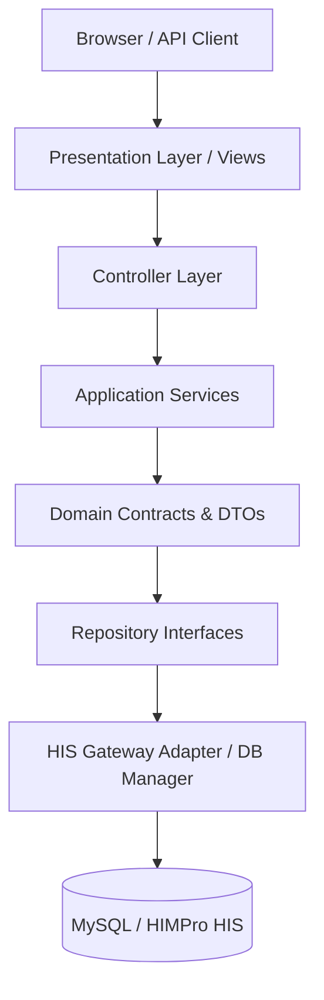

# TomvisHIMPro System Architecture Specification

## Architecture Overview
TomvisHIMPro adopts a **Modular Monolith** architecture designed for enterprise hospital applications. It ensures strict decoupling between Framework Core, HIS Data Adapters, and Clinical Application Modules.

## Layer Definitions
1. **Presentation Layer (`resources/views/`, `public/`):**
   Responsive Bootstrap 5 UI, DataTables, Chart.js, Sarabun typography, Thai/English localization.
2. **Controller Layer (`app/Core/Controller/`, `app/Modules/*/`):**
   Handles incoming request mapping, parameter validation, and response rendering. No direct SQL execution.
3. **Application Service Layer (`app/Core/`):**
   DI Container, Routing pipeline, Middleware stack (CSRF, Auth, RBAC, RateLimit), Logger, Exception Handler.
4. **Domain Layer (`app/Contracts/HIS/DTOs/`):**
   Canonical Data Transfer Objects (`PatientDTO`, `VisitDTO`, `AllergyDTO`, `MedicationDTO`, `LabResultDTO`).
5. **Repository Interface (`app/Contracts/HIS/`):**
   Decoupled interfaces (`PatientRepositoryInterface`, `AllergyRepositoryInterface`, etc.).
6. **Infrastructure Adapters (`app/Infrastructure/HIMPro/`):**
   `MockHISAdapter`, `HIMProReadOnlyAdapter`, `HIMProLegacyAdapter`, `CSVImportAdapter`.
