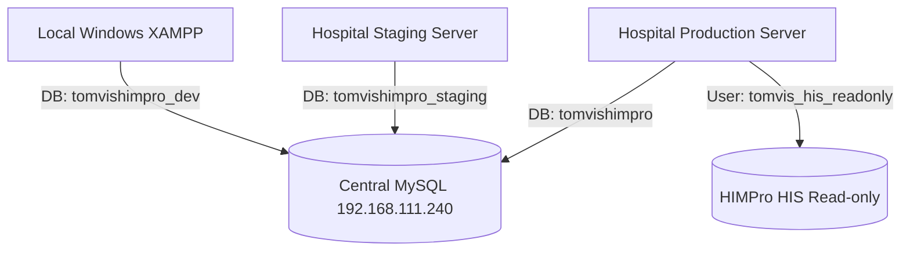

# TomvisHIMPro v2.1 — Centralized Database Architecture Specification

## Architecture Overview
TomvisHIMPro v2.1 introduces a **Centralized Database Server Architecture** connecting Windows XAMPP local development, hospital staging, and hospital production to a central MySQL instance at `192.168.111.240:3306` with **Zero Manual Reconfiguration Deployment**.

## Database Separation & Privilege Policy

| Environment | Host | Logical Database | User Account | Access Rights |
| :--- | :--- | :--- | :--- | :--- |
| **Development** | `192.168.111.240` | `tomvishimpro_dev` | `tomvis_dev_app` | ALL PRIVILEGES on `tomvishimpro_dev.*` |
| **Staging** | `192.168.111.240` | `tomvishimpro_staging` | `tomvis_staging_app` | ALL PRIVILEGES on `tomvishimpro_staging.*` |
| **Production** | `192.168.111.240` | `tomvishimpro` | `tomvis_prod_app` | SELECT, INSERT, UPDATE, DELETE on `tomvishimpro.*` |
| **HIS Gateway** | `192.168.111.240` | `himpro_his` | `tomvis_his_readonly` | SELECT ONLY on allowlisted tables/views |

## Hard Environment Isolation Guards
- **Local Guard:** If `APP_ENV=local`, connection to `tomvishimpro` (Production DB) is **BLOCKED**.
- **Production Guard:** If `APP_ENV=production`, connection to `tomvishimpro_dev` is **BLOCKED**.
- **HIS Mode Guard:** If `HIS_MODE=mock`, live connection to HIMPro HIS database is **BLOCKED**.
