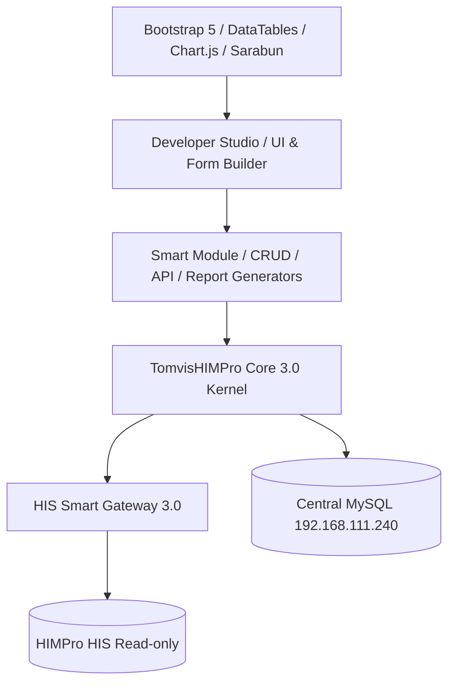

# TomvisHIMPro 3.0 — Hospital RAD Platform Architecture

## Core Architectural Vision
TomvisHIMPro 3.0 adopts a **Modular Monolith + Plugin Architecture** designed specifically for enterprise hospital web application development.

```
ONE FRAMEWORK. ONE HIS GATEWAY. ONE DEVELOPER STUDIO. MULTIPLE HOSPITAL APPLICATIONS.
```



## Layer Architecture Breakdown
1. **Developer Studio Layer (`/developer`):**
   - 10-step Project Wizard
   - Module & CRUD Generator
   - Clinical Form Builder
   - API Generator & Explorer
   - Report Builder
   - Test Runner & Security Lab
   - Deployment & Registry Manager
2. **Application Kernel Layer (`app/Core/`):**
   - Dependency Injection Container (PSR-11)
   - Pipeline Router (PSR-15)
   - Configuration & Environment Manager
   - Event Dispatcher & Cache Manager
   - Feature Flag Engine
   - Background Job Queue Worker
3. **Domain & HIS Interoperability Layer (`app/Contracts/`, `app/Infrastructure/`):**
   - Canonical Healthcare Models (Patient, Encounter, Visit, Diagnosis, Medication, Allergy, Lab, Admission)
   - FHIR R4 Interoperability Foundation
   - Read-Only HIMPro Gateway Adapters
4. **Application Modules Layer (`app/Modules/`):**
   - Reference Module: **PDH Pharmacy Queue System**
   - Custom Hospital Modules (generated dynamically via Developer Studio)
